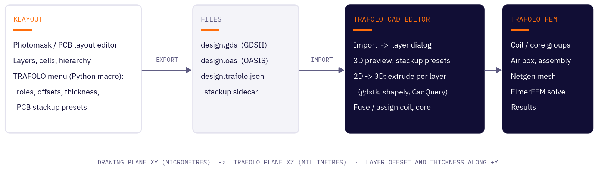
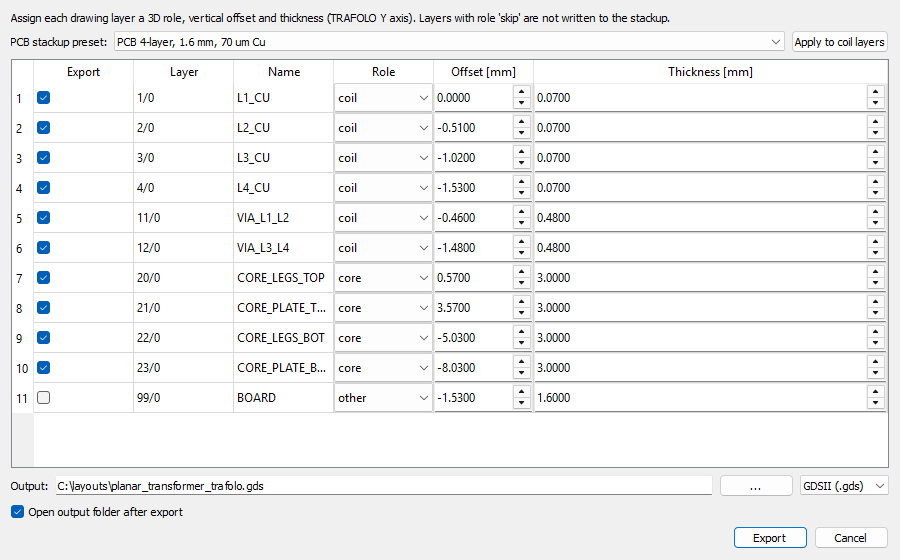
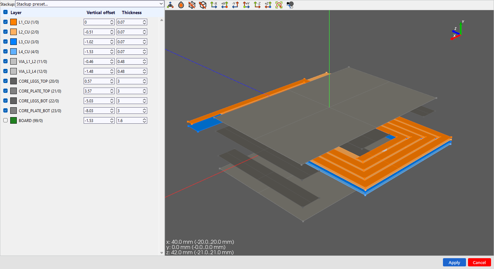
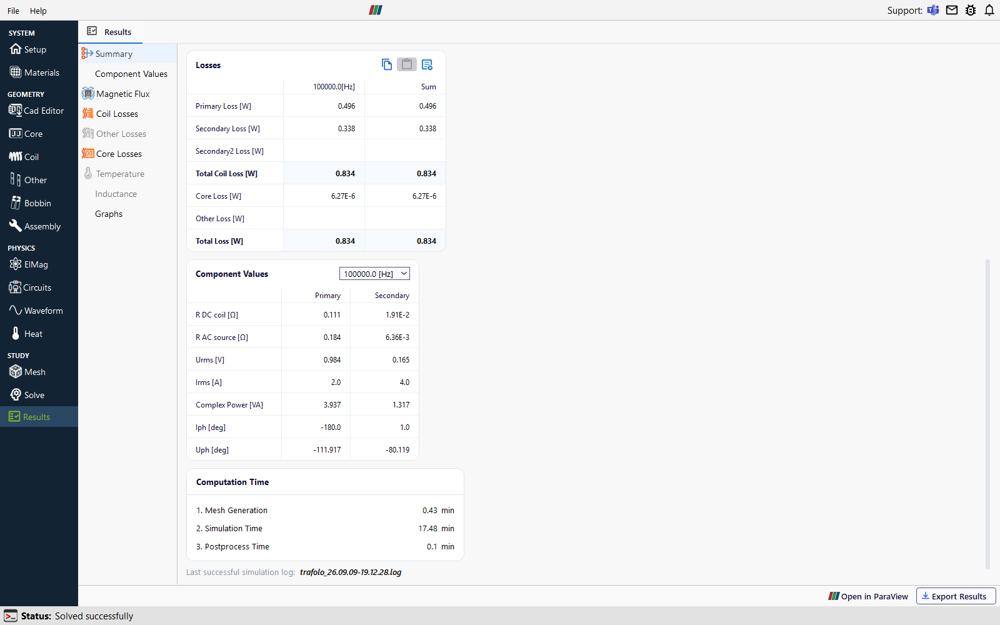

# TRAFOLO for KLayout

Simulate the magnetic components you draw in [KLayout](https://www.klayout.de). Draw or open a
GDSII or OASIS layout, describe the layer stack once, and TRAFOLO turns every layer into a 3D
solid ready for electromagnetic simulation: PCB planar transformers, thin-film spiral inductors,
planar toroids and other integrated magnetic components.

| KLayout: export with the layer stack | TRAFOLO: layers become 3D solids | TRAFOLO: solved model |
|---|---|---|
|  |  |  |

Watch the workflow in a 4½-minute video: [Thin-film spiral inductor from KLayout to TRAFOLO](https://youtu.be/Z05oW3sGpQ0).

## What is in this repository

| Folder | Contents |
|---|---|
| [`macro/`](macro) | `trafolo_export.lym`, a KLayout macro that adds a **TRAFOLO** menu with **Export for TRAFOLO…** |
| [`examples/`](examples) | Seven ready-to-import layouts, each as `.gds` and `.oas` with layer colours (`.lyp`) and a stack description (`.trafolo.json`) |
| [`docs/`](docs) | Installation, step-by-step workflow, the stack file format and troubleshooting |

## Requirements

- **TRAFOLO 1.43 or newer** ([trafolo.eu](https://trafolo.eu)). The layout import is part of the CAD editor.
- **KLayout 0.30** or newer, only if you want to edit layouts or export your own. The example files
  import into TRAFOLO without KLayout.

## Quick start

1. **Install the macro**: copy [`macro/trafolo_export.lym`](macro/trafolo_export.lym) to
   `%USERPROFILE%\KLayout\pymacros\` and restart KLayout. A **TRAFOLO** menu appears.
   Details for every platform: [docs/install.md](docs/install.md).
2. **Export**: open your layout, choose **TRAFOLO → Export for TRAFOLO…**, give each layer a role,
   a vertical offset and a thickness (or pick a PCB preset), and press **Export**. KLayout writes the
   layout and a `<name>.trafolo.json` stack file next to it.
3. **Import**: in TRAFOLO open the **Cad Editor**, press **Import** and pick the `.gds` or `.oas`.
   The layer dialog opens with the stack already filled in. Press **Apply**.
4. **Build the model**: fuse each winding's copper and via layers into one solid, press **Apply** to
   create the coil and core groups, then assemble, mesh and solve as with any other TRAFOLO model.

No KLayout at hand? Import [`examples/planar_transformer.gds`](examples/planar_transformer.gds)
straight into TRAFOLO; its stack file comes along automatically.

## Documentation

- [Installation](docs/install.md)
- [Workflow, step by step](docs/workflow.md)
- [The stack file (`.trafolo.json`)](docs/stack-file.md)
- [Example layouts](examples/README.md)
- [Troubleshooting and limits](docs/troubleshooting.md)
- TRAFOLO user manual: [trafolo.eu/documentation](https://trafolo.eu/documentation/)

## Support

Questions and bug reports: open an issue in this repository, or contact TRAFOLO through
[trafolo.eu](https://trafolo.eu). Please attach the layout and its `.trafolo.json` when reporting an
import problem.

## License

The macro, the example layouts and the documentation are released under the [MIT License](LICENSE).
TRAFOLO itself is commercial software with its own licence terms.
