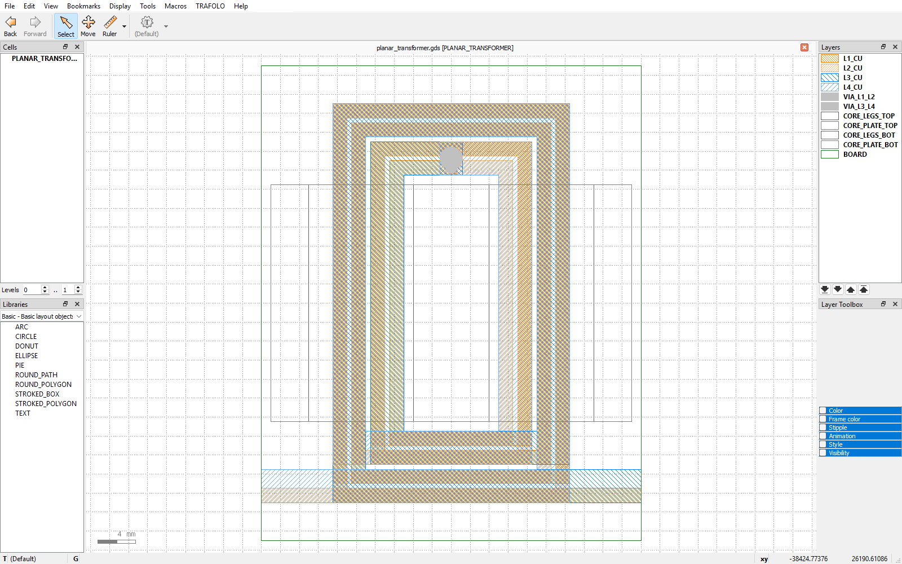

# Installation

## TRAFOLO

Install TRAFOLO 1.43 or newer from [trafolo.eu](https://trafolo.eu). Check the import is there:
open the **Cad Editor**, press **Import**, and look at the file-type filter. It lists
**KLayout GDSII** and **KLayout OASIS**.

## The KLayout macro

The macro adds a **TRAFOLO** menu to KLayout with two entries:

- **Export for TRAFOLO…** writes the layout together with its layer stack.
- **TRAFOLO documentation** opens the TRAFOLO user manual.



### Windows

1. Install [KLayout](https://www.klayout.de) 0.30 or newer and **start it once**. This creates your
   KLayout user folder, `C:\Users\<your name>\KLayout`.
2. Copy [`macro/trafolo_export.lym`](../macro/trafolo_export.lym) into
   `%USERPROFILE%\KLayout\pymacros\`. Use the user folder, not the folder KLayout is installed in.
3. Restart KLayout. The **TRAFOLO** menu sits between **Macros** and **Help**.

The same in PowerShell, run from a copy of this repository:

```powershell
mkdir -Force "$env:USERPROFILE\KLayout\pymacros" > $null; copy macro\trafolo_export.lym "$env:USERPROFILE\KLayout\pymacros\"
```

### Linux and macOS

Copy the macro to `~/.klayout/pymacros/` and restart KLayout:

```bash
mkdir -p ~/.klayout/pymacros && cp macro/trafolo_export.lym ~/.klayout/pymacros/
```

The export works the same way. Untick **Open output folder after export** in the export dialog;
opening the folder is supported on Windows only.

### The menu does not appear

Open **Macros → Macro Development** in KLayout. `trafolo_export` must be listed under **Python**. If
it is not there, the file is in the wrong folder or its extension is not `.lym`. If it is listed but
the menu is missing, check that the macro's **Run on startup** option is ticked in the macro
properties.

## Updating

Copy the new `trafolo_export.lym` over the old one and restart KLayout.
