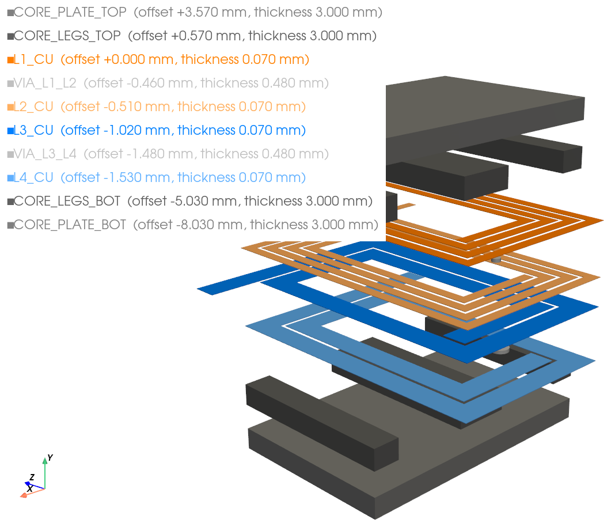
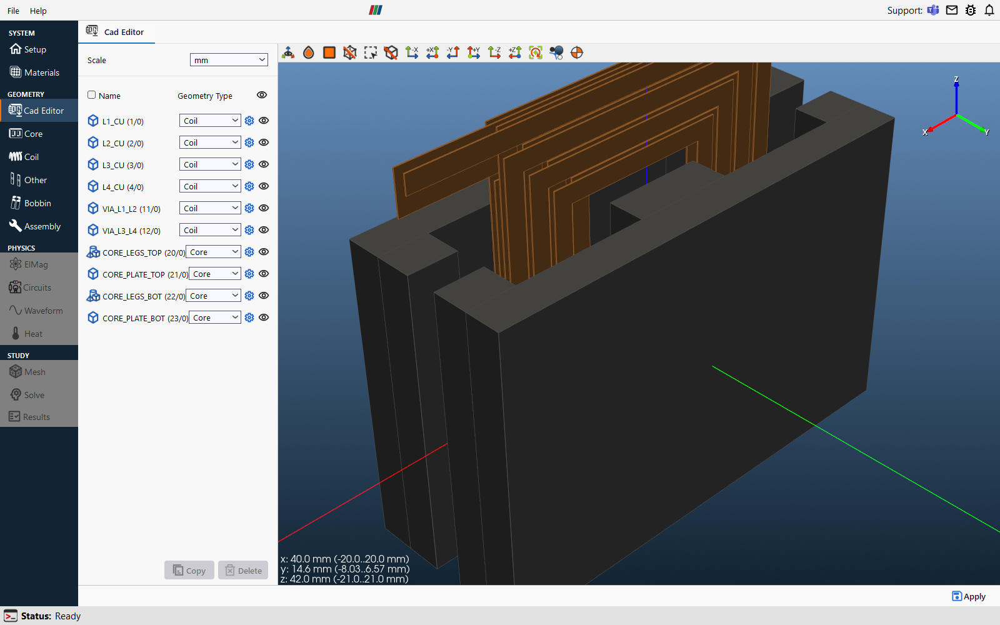
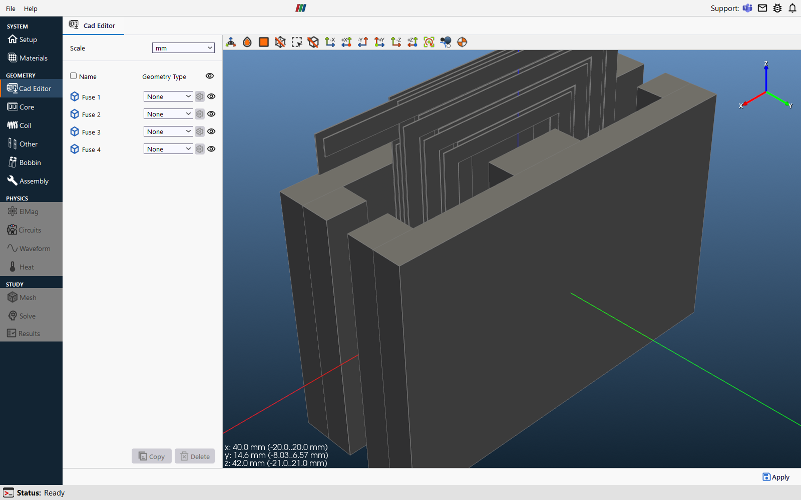
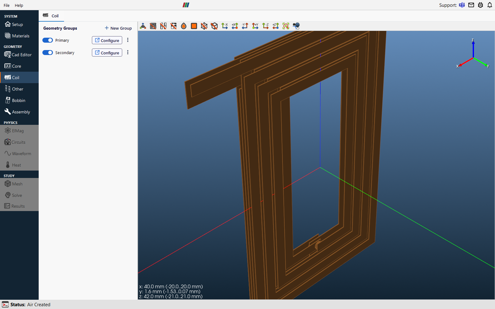
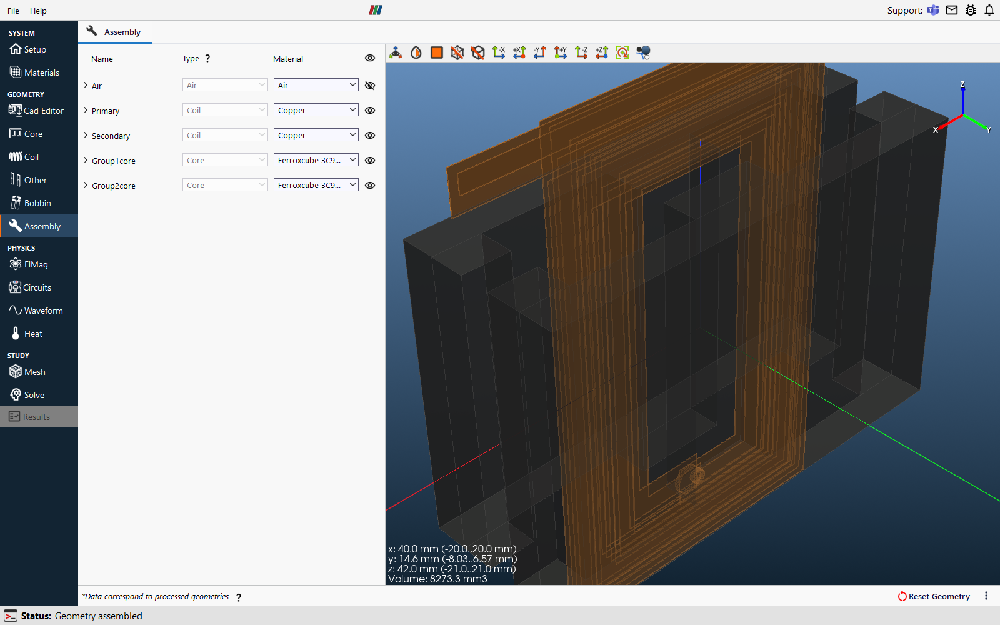
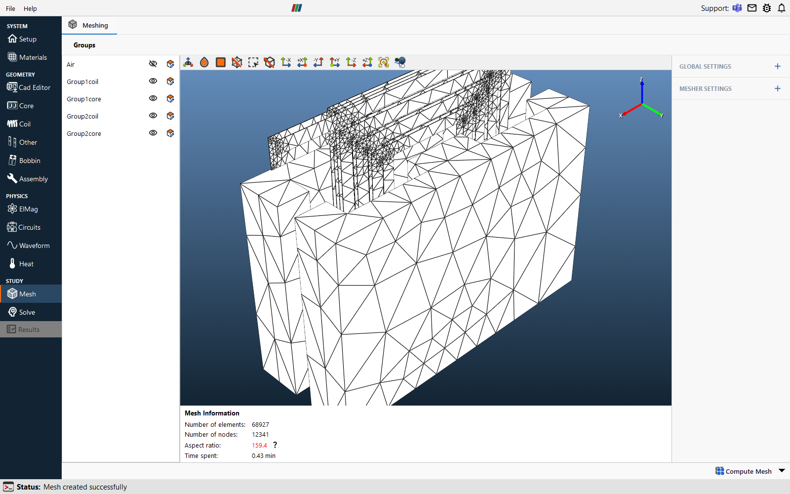

# Workflow, step by step

This walk-through uses the four-layer PCB planar transformer in
[`examples/planar_transformer.gds`](../examples/planar_transformer.gds). The thin-film examples work
the same way, only in micrometres.

## 1. Open the layout in KLayout

Open the `.gds` with **File → Open**, then load the matching `.lyp` with
**File → Load Layer Properties** so that layers have names and colours. The planar transformer has
four copper layers, two via layers, four core layers and a board outline.

The layout itself is a normal GDSII or OASIS file. Nothing TRAFOLO-specific is stored in it.

## 2. Export for TRAFOLO

Choose **TRAFOLO → Export for TRAFOLO…**. The dialog lists every drawn layer of the open layout.

For each layer set:

| Column | Meaning |
|---|---|
| **Export** | Untick to keep the layer in the stack file but leave it out of the 3D model. |
| **Role** | `coil` (conductors and vias), `core` (magnetic material), `bobbin`, `other`, or `skip` to leave the layer out of the stack file. The role is guessed from the layer name: names containing *core* or *ferrite* become `core`, *board*, *pcb* or *fr4* become `other`, everything else `coil`. |
| **Offset [mm]** | Height of the layer's **bottom** face. |
| **Thickness [mm]** | Layer thickness, measured upwards from the offset. |

**PCB stackup preset** with **Apply to coil layers** fills the copper layers of a standard 1.6 mm
board (2, 4 or 6 layers, 35 or 70 µm copper) in one go. Vias and core layers are typed in by hand;
the values for this example are in [examples/README.md](../examples/README.md).

Choose GDSII or OASIS as the output format and press **Export**. Two files are written:

- `planar_transformer_trafolo.gds`, the layout with layer names stored in the file;
- `planar_transformer_trafolo.trafolo.json`, the stack file. See [stack-file.md](stack-file.md).

Keep both files in the same folder. TRAFOLO finds the stack file by its name.

## 3. Import into TRAFOLO

In TRAFOLO create a project, open the **Cad Editor** and press **Import**. Pick the `.gds` or `.oas`.
The layer dialog opens with offsets and thicknesses filled in from the stack file and a 3D preview
of every layer.

You can still change any value here, tick layers on or off, or use the **Stackup** preset list when
there is no stack file. Press **Apply**. Every layer becomes one or more solids at its height.

## 4. Fuse windings and create groups

A winding usually spans several layers. Select the layers that form one winding and press **Fuse**:
here `L1_CU`, `VIA_L1_L2` and `L2_CU` give the primary, `L3_CU`, `VIA_L3_L4` and `L4_CU` the
secondary. Fuse the two layers of each core half the same way.

Check the **Geometry Type** of each solid (Coil or Core). Roles from the stack file are already
applied. Press **Apply** at the bottom right: TRAFOLO creates the coil and core groups.

## 5. Set up the simulation

From here the model is an ordinary TRAFOLO model. For the planar transformer:

| Page | Setting |
|---|---|
| **Coil** | Primary 8 turns (4 + 4), secondary 4 turns (2 + 2), winding type Massive |
| **Setup** | Harmonic, heat transfer off, full domain |
| **ElMag** | Secondary winding enabled, both windings in series |
| **Waveform** | 100 kHz, primary 2 A rms, secondary 4 A rms at −179° |
| **Materials** | Copper for the windings, a ferrite such as Ferroxcube 3C95 for the core |

## 6. Assemble, mesh, solve

On the **Assembly** page lock the air box to the planes where the winding terminals leave the
device, here X from −20 to 20 mm, and leave the other limits automatic. Press **Assemble**: TRAFOLO
detects the terminals on the fused windings.

Mesh with Netgen (coarse refinement is enough for a first run) and solve. Several CPU cores make a
large difference; this model solves in minutes on 8 cores.

## 7. Results

The results page shows losses per winding, DC and AC resistance and inductance. For this example
expect roughly 69 thousand mesh elements, 0.50 W loss in the primary, 0.34 W in the secondary and
0.73 µH primary inductance; your numbers will differ slightly with mesh settings. **Open in
ParaView** shows field and current-density plots.

## Changing the design

Edit the layout in KLayout, save, and export again. The stack file is rewritten with the values in
the dialog. Import the new file into TRAFOLO and build the model as before.
