# Example layouts

Seven layouts, each in four files:

| File | Contents |
|---|---|
| `<name>.gds` and `<name>.oas` | The same drawing as GDSII and as OASIS |
| `<name>.lyp` | KLayout layer properties: names and colours |
| `<name>.trafolo.json` | The layer stack, read automatically by TRAFOLO on import |

Import any `.gds` or `.oas` in TRAFOLO's **Cad Editor** with **Import**. The layer dialog fills
itself in from the stack file. To look at a layout in KLayout, open the `.gds` and load the matching
`.lyp` with **File → Load Layer Properties**.

| Layout | Units | Size | What it is |
|---|---|---|---|
| [`planar_transformer`](#planar_transformer) | mm | 40 × 50 mm | Four-layer PCB planar transformer with a planar E-core |
| [`spiral_single`](#spiral_single-and-spiral_array) | µm | 800 × 800 µm | Thin-film spiral power inductor die |
| [`spiral_array`](#spiral_single-and-spiral_array) | µm | 1.8 × 1.8 mm | The same die as a 2 × 2 array |
| [`spiral_inductor`](#spiral_inductor) | µm | 260 × 430 µm | Square spiral with an air-bridge crossover |
| [`racetrack_inductor`](#racetrack_inductor) | µm | 640 × 400 µm | Racetrack spiral under a magnetic film |
| [`planar_toroid`](#planar_toroid) | µm | 2.2 × 2.2 mm | Annular magnetic core with a wedge-and-via winding |
| [`flat_solenoid`](#flat_solenoid) | µm | 2.1 × 2.4 mm | Frame core with a flat-layer solenoid winding |

Offsets are the bottom face of each layer; thickness runs upwards from it.

## planar_transformer

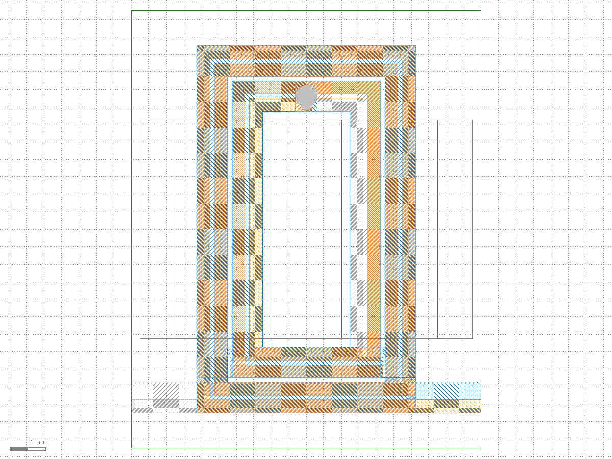

Primary: `L1_CU` + `L2_CU`, four turns each, joined through `VIA_L1_L2`. Secondary: `L3_CU` +
`L4_CU`, two turns each, joined through `VIA_L3_L4`. Each core half is drawn as legs plus plate.
The terminals leave the board at x = ±20 mm, so lock the air box to those planes. The full
walk-through is in [docs/workflow.md](../docs/workflow.md).

| Layer | Name | Role | Offset [mm] | Thickness [mm] | Imported |
|---|---|---|---|---|---|
| 1/0 | L1_CU | coil | 0 | 0.07 | yes |
| 2/0 | L2_CU | coil | −0.51 | 0.07 | yes |
| 3/0 | L3_CU | coil | −1.02 | 0.07 | yes |
| 4/0 | L4_CU | coil | −1.53 | 0.07 | yes |
| 11/0 | VIA_L1_L2 | coil | −0.46 | 0.48 | yes |
| 12/0 | VIA_L3_L4 | coil | −1.48 | 0.48 | yes |
| 20/0 | CORE_LEGS_TOP | core | 0.57 | 3 | yes |
| 21/0 | CORE_PLATE_TOP | core | 3.57 | 3 | yes |
| 22/0 | CORE_LEGS_BOT | core | −5.03 | 3 | yes |
| 23/0 | CORE_PLATE_BOT | core | −8.03 | 3 | yes |
| 99/0 | BOARD | other | −1.53 | 1.6 | no |

The copper rows match the preset **PCB 4-layer, 1.6 mm, 70 µm Cu**. The vias are 0.48 mm tall so
that they overlap the copper they connect. The board layer is disabled: the copper lies inside its
volume, which a plain solid cannot represent. For a capacitance study enable it, cut the windings
out of it in the CAD editor and give it a dielectric material.

## spiral_single and spiral_array

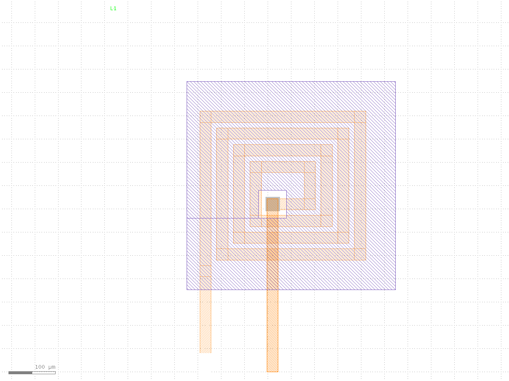

Electroplated copper spiral on a substrate, a sputtered magnetic film between the spiral and the
top-metal bridge, and a copper stud from the inner end of the spiral up to the bridge.

| Layer | Name | Role | Offset [µm] | Thickness [µm] | Imported |
|---|---|---|---|---|---|
| 1/0 | M1_BOTTOM_CU | coil | 0 | 10 | yes |
| 2/0 | VIA_CU | coil | 9.5 | 16 | yes |
| 3/0 | M2_TOP_CU | coil | 25 | 10 | yes |
| 10/0 | MAG_CORE | core | 12 | 5 | yes |
| 1/2 | PAD_OPEN | other | 0 | 0 | no |

The stud starts 0.5 µm below the top of `M1_BOTTOM_CU` and ends 0.5 µm above the bottom of
`M2_TOP_CU`, so the three copper layers fuse into one winding. The magnetic film touches neither and
has a clearance opening where the stud passes through it.

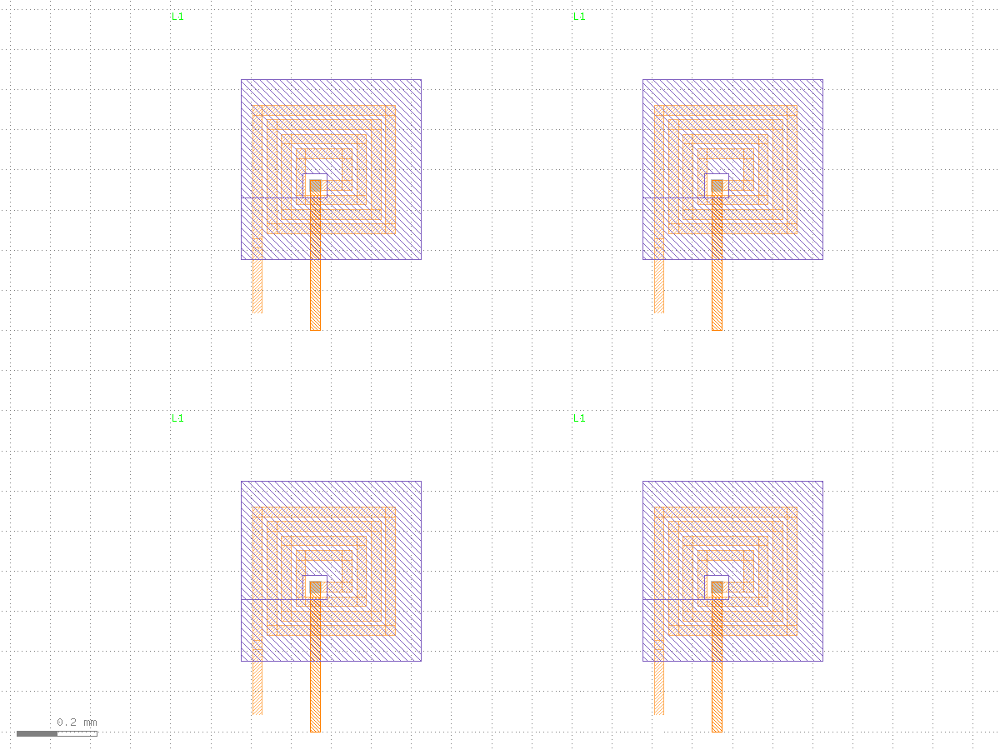

`spiral_array` is drawn the way production layouts are: the top cell holds only a 2 × 2 array of the
die cell, the spiral is built from overlapping straight bars, the film opening is stored as a
keyhole cut, layer 1 carries metal on datatype 0 and pad openings on datatype 2, and one layer holds
only a text label. It imports as four layers with four solids each.

## spiral_inductor

| KLayout | TRAFOLO |
|---|---|
| 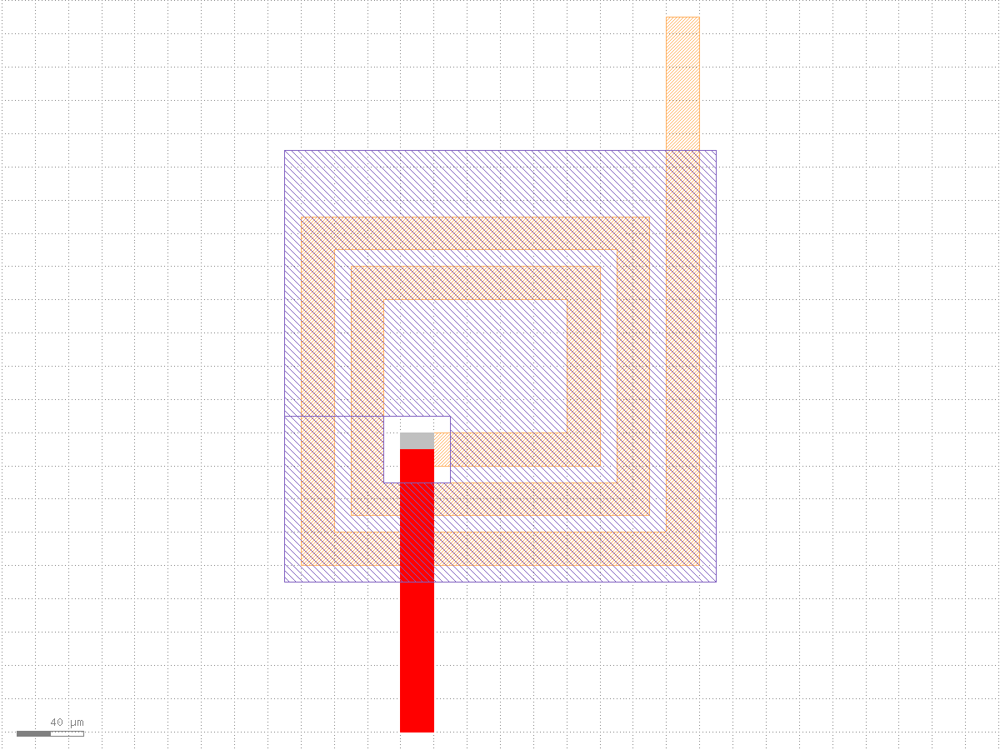 | 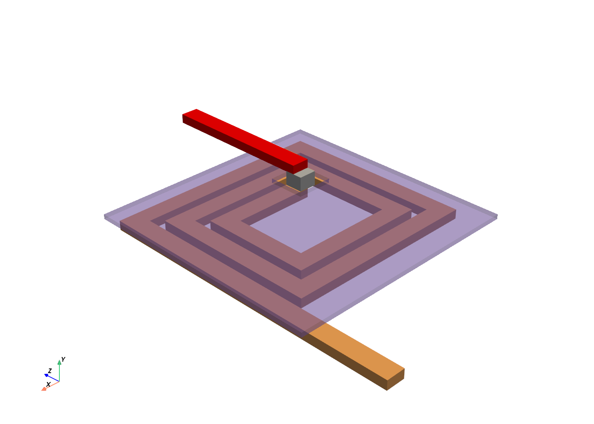 |

| Layer | Name | Role | Offset [µm] | Thickness [µm] | Imported |
|---|---|---|---|---|---|
| 1/0 | M1_BOTTOM_CU | coil | 0 | 10 | yes |
| 2/0 | VIA_CU | coil | 9.5 | 16 | yes |
| 4/0 | AIR_BRIDGE_CU | coil | 25 | 10 | yes |
| 10/0 | MAG_CORE | core | 12 | 5 | yes |

## racetrack_inductor

| KLayout | TRAFOLO |
|---|---|
| 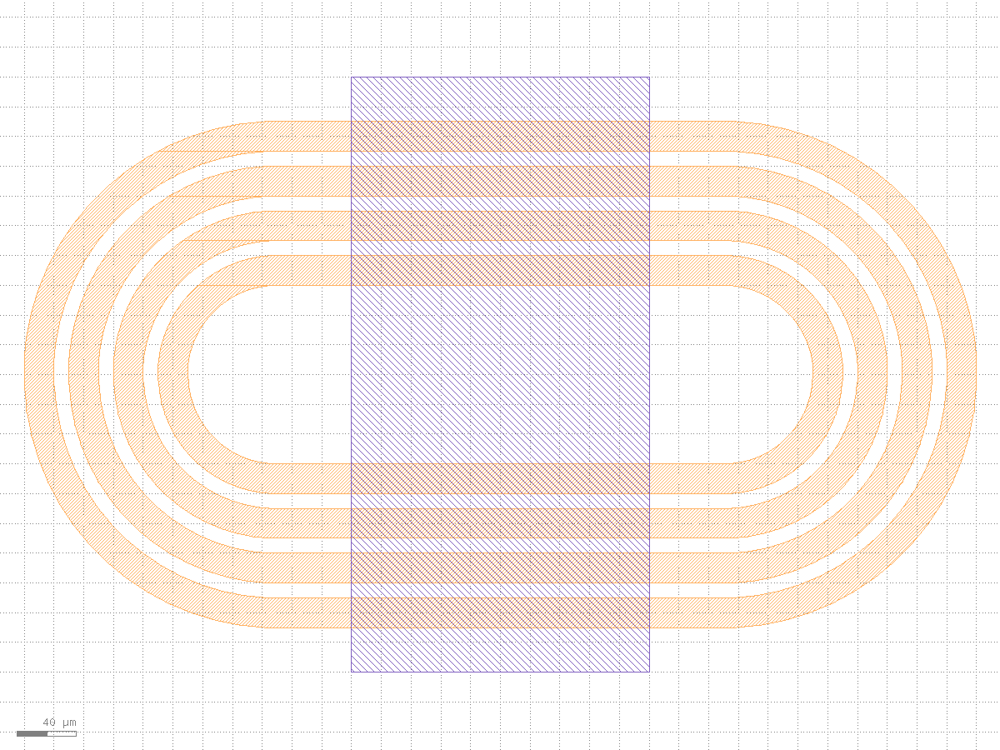 | 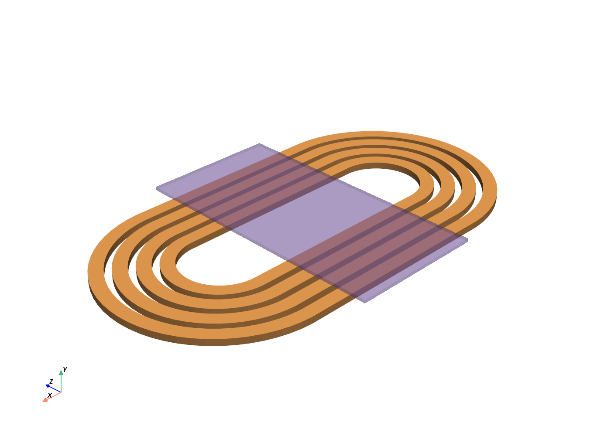 |

| Layer | Name | Role | Offset [µm] | Thickness [µm] | Imported |
|---|---|---|---|---|---|
| 1/0 | M1_BOTTOM_CU | coil | 0 | 10 | yes |
| 10/0 | MAG_CORE | core | 15 | 5 | yes |

## planar_toroid

| KLayout | TRAFOLO |
|---|---|
| 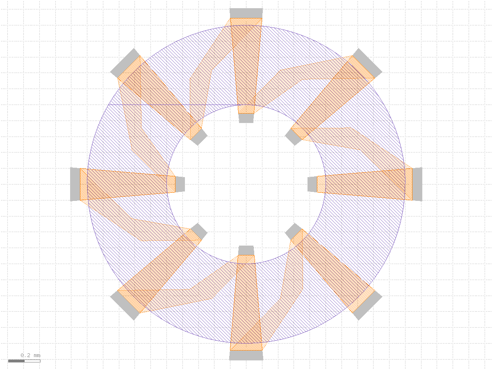 | 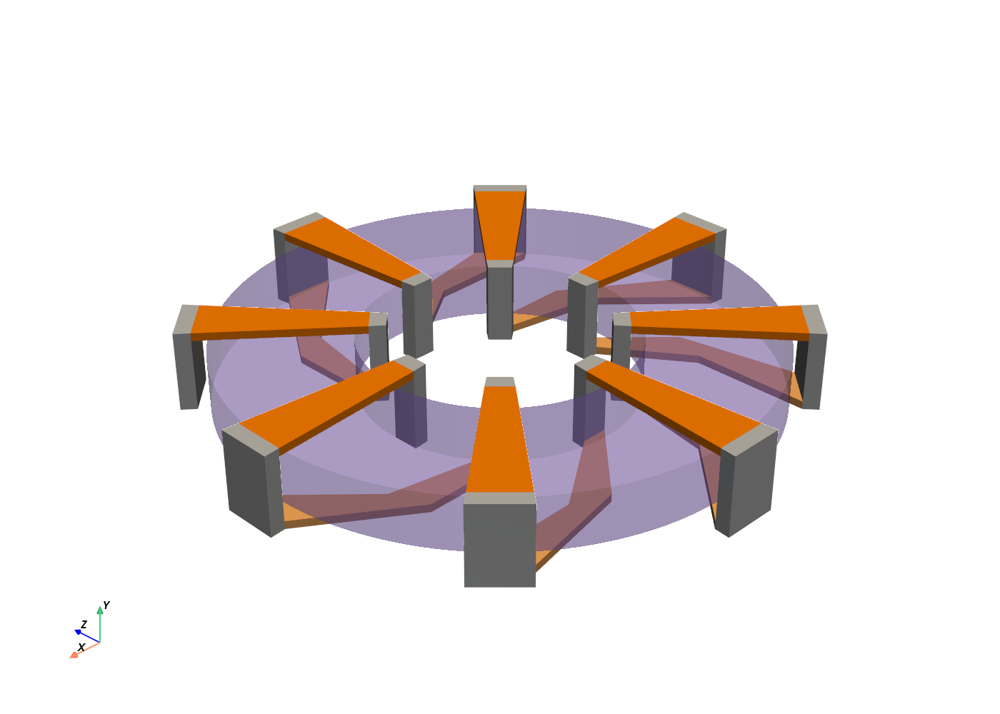 |

| Layer | Name | Role | Offset [µm] | Thickness [µm] | Imported |
|---|---|---|---|---|---|
| 1/0 | M1_BOTTOM_CU | coil | −150 | 30 | yes |
| 2/0 | VIA_CU | coil | −150 | 300 | yes |
| 3/0 | M2_TOP_CU | coil | 120 | 30 | yes |
| 10/0 | MAG_CORE | core | −100 | 200 | yes |

The via layer spans from the bottom copper to the top copper, so each turn fuses into one closed
loop around the core.

## flat_solenoid

| KLayout | TRAFOLO |
|---|---|
| 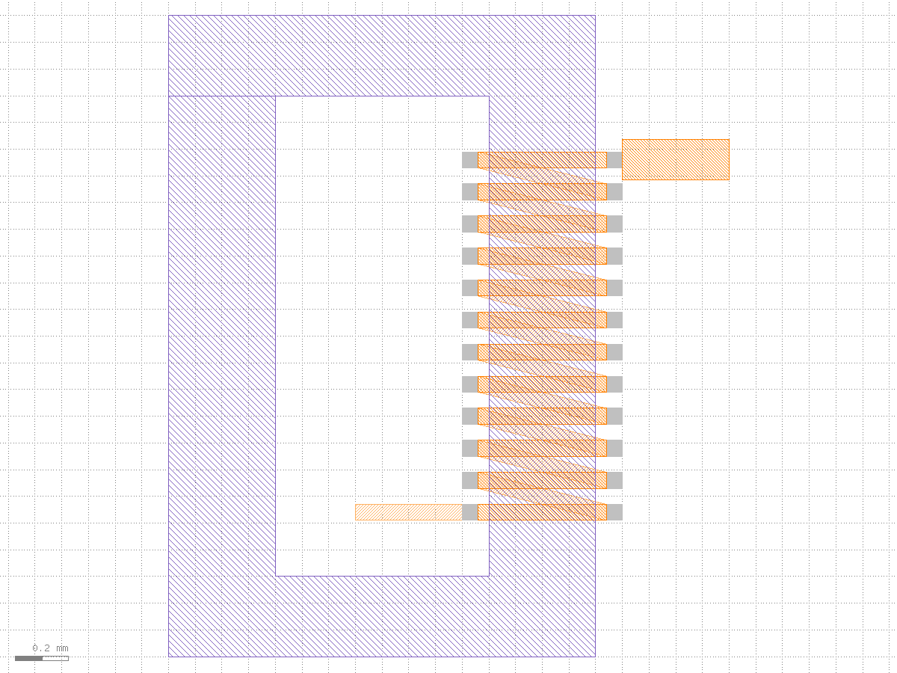 | 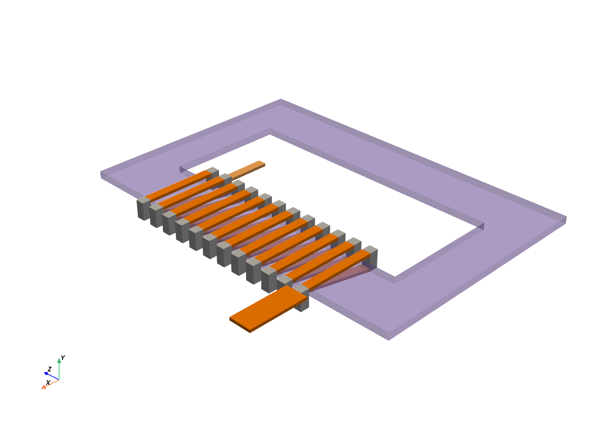 |

| Layer | Name | Role | Offset [µm] | Thickness [µm] | Imported |
|---|---|---|---|---|---|
| 1/0 | M1_BOTTOM_CU | coil | −35 | 20 | yes |
| 2/0 | VIA_CU | coil | −35 | 120 | yes |
| 3/0 | M2_TOP_CU | coil | 65 | 20 | yes |
| 10/0 | MAG_CORE | core | 0 | 50 | yes |
